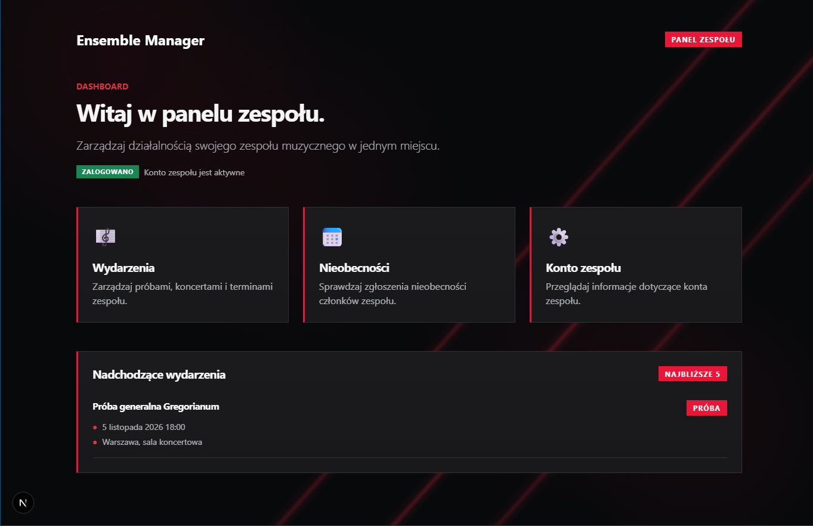
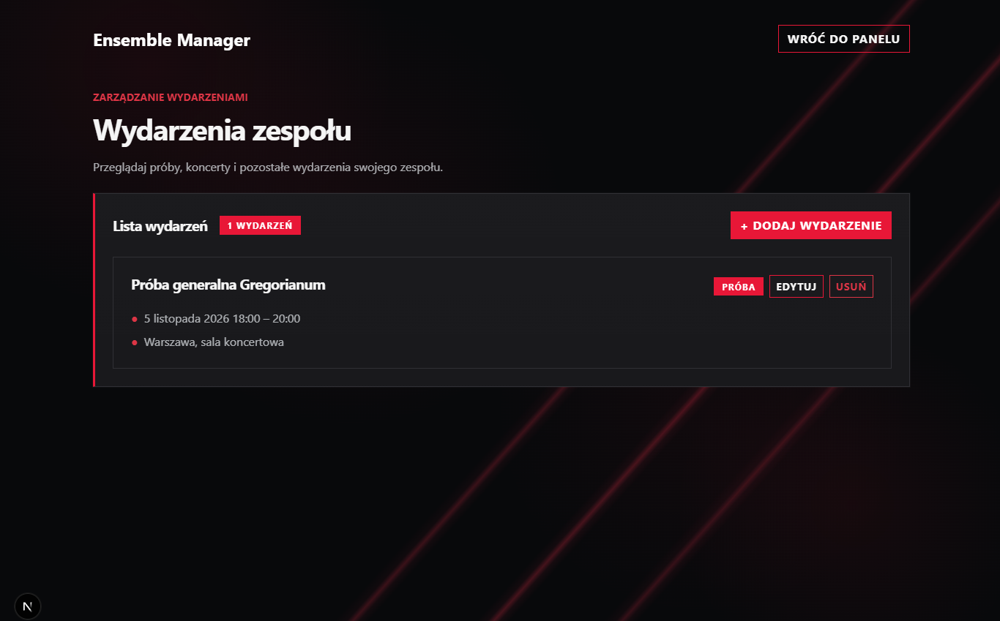
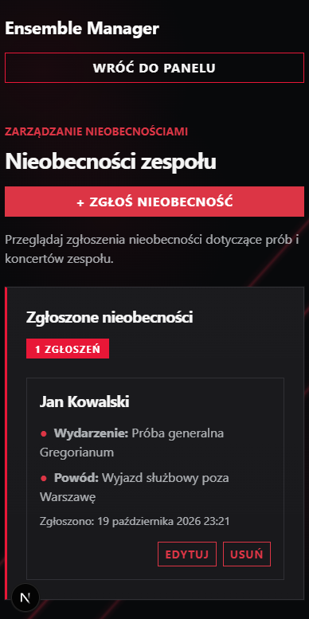

# Ensemble Manager

**Aplikacja webowa do zarządzania wydarzeniami i nieobecnościami w zespole muzycznym**  
Projekt zaliczeniowy z przedmiotu **Frameworki Programowania** (2026/2027).

## 1. Opis projektu

Ensemble Manager pomaga zespołom muzycznym, np. chórom, planować próby i koncerty oraz prowadzić zgłoszenia nieobecności. Każdy zespół ma osobne konto, a jego dane są izolowane od danych pozostałych zespołów. Użytkownik pracuje w responsywnym interfejsie w ciemnym motywie, zbudowanym na Bootstrapie.

**Zaimplementowane funkcje:**

- logowanie przez Supabase Auth i ochrona stron wymagających uwierzytelnienia;
- przegląd nadchodzących wydarzeń na panelu zespołu;
- pełny CRUD wydarzeń (próby, koncerty, inne wydarzenia);
- pełny CRUD zgłoszeń nieobecności powiązanych z wydarzeniami;
- walidacja danych w formularzach, API oraz ograniczenia na poziomie bazy danych;
- izolacja danych zespołów przy użyciu PostgreSQL Row Level Security (RLS);
- wyświetlanie i wprowadzanie terminów według strefy `Europe/Warsaw`, z zapisem jednoznacznych chwil w UTC;
- automatyczne testy Playwright i pipeline CI w GitHub Actions.

Model dostępu: **jedno konto Supabase Auth odpowiada jednemu zespołowi**. Nie jest to system indywidualnych kont wszystkich członków chóru.

## 2. Technologie i frameworki

Trzy główne frameworki spełniają odrębne role wymagane na zajęciach:

| Framework | Wersja w projekcie | Kategoria | Zastosowanie |
|---|---|---|---|
| **Next.js** | **16.4.3** | A — framework aplikacyjny | App Router, strony serwerowe i klienckie, dynamiczne ścieżki, Route Handlers REST API, budowanie wersji produkcyjnej |
| **Bootstrap** | **5.3.8** | B — framework UI | responsywna siatka, formularze, przyciski, karty, alerty, badge, własny ciemny motyw |
| **Playwright** | **1.64.1** (zakres `^1.64.1`) | C — framework testowy | testy przeglądarkowe, API, scenariusze CRUD, walidacja i izolacja danych |

Pozostałe narzędzia: **React 19.3.0**, **TypeScript 5**, **Supabase** (Auth + PostgreSQL + RLS), `@supabase/ssr`, `@supabase/supabase-js`, **`@js-temporal/polyfill` 0.5.1**, **GitHub Actions**.

**Uzasadnienie wyboru:** Next.js pozwala utrzymać interfejs i REST API w jednym projekcie zamiast budować osobny backend. Bootstrap zapewnia gotowy system responsywności i komponentów bez tworzenia całego UI od zera. Playwright bada zachowanie rzeczywistej przeglądarki oraz operacje HTTP, a nie wyłącznie pojedyncze funkcje. Alternatywami byłyby np. NestJS + oddzielny frontend, Tailwind CSS oraz Cypress; wybrany zestaw jest prostszy w utrzymaniu dla zakresu tego projektu.

## 3. Wymagania

- **Node.js 24** (wersja używana w projekcie i GitHub Actions);
- **npm**;
- projekt **Supabase** z aktywną bazą PostgreSQL i skonfigurowanym Supabase Auth;
- przeglądarka internetowa; do Playwright — Chromium zainstalowany przez CLI.

Projekt jest przygotowany do pracy w Windows/PowerShell. Na Linux/macOS można użyć odpowiedników `npm`/`npx` bez rozszerzenia `.cmd`.

## 4. Instalacja i uruchomienie

```powershell
# Pobranie projektu
git clone https://github.com/dobrywektor37/ensemble-manager.git
cd ensemble-manager

# Instalacja zależności z pliku lock
npm.cmd ci

# Lokalne zmienne środowiskowe
Copy-Item .env.example .env.local
```

W pliku `.env.local` uzupełnij:

```dotenv
NEXT_PUBLIC_SUPABASE_URL=https://TWOJ-PROJEKT.supabase.co
NEXT_PUBLIC_SUPABASE_PUBLISHABLE_KEY=TWOJ_KLUCZ_PUBLISHABLE
```

Są to adres i **klucz publiczny/publishable** projektu Supabase, a nie `service_role` ani sekret administratora. Nie umieszczaj w repozytorium haseł, tokenów sesyjnych ani kluczy uprzywilejowanych. Zasady RLS zapewniają kontrolę dostępu do danych.

Baza wymaga schematu z migracji:

`supabase/migrations/20261013223756_initial_schema.sql`

Migracja tworzy tabele `teams`, `events`, `absences`, klucze obce, ograniczenia, indeksy i polityki RLS. Można ją zastosować w odpowiednio skonfigurowanym projekcie Supabase (np. przez Supabase CLI). Konto utworzone w Supabase Auth musi mieć odpowiadający rekord w `public.teams` o `id` równym identyfikatorowi użytkownika Auth. Aplikacja **nie udostępnia obecnie publicznego formularza rejestracji ani automatycznego zakładania zespołu** — konta i rekordy zespołów należy przygotować administracyjnie.

Uruchom serwer deweloperski:

```powershell
npm.cmd run dev
```

Otwórz `http://localhost:3000` i zaloguj się pod `/login` na wcześniej skonfigurowane konto zespołu.

### Wersja produkcyjna

```powershell
npm.cmd run lint
npm.cmd run build
npm.cmd run start
```

Domyślny adres lokalny: `http://localhost:3000`. Polecenie `next start` wymaga wcześniejszego udanego `next build`.

## 5. Widoki aplikacji

| Ścieżka | Opis |
|---|---|
| `/` | strona startowa |
| `/login` | formularz logowania Supabase Auth |
| `/dashboard` | panel zespołu z nadchodzącymi wydarzeniami |
| `/events` | lista wszystkich wydarzeń zalogowanego zespołu |
| `/events/new` | formularz dodawania wydarzenia |
| `/events/[id]/edit` | dynamiczna strona edycji wydarzenia |
| `/absences` | lista zgłoszeń nieobecności |
| `/absences/new` | formularz dodawania zgłoszenia |
| `/absences/[id]/edit` | dynamiczna strona edycji nieobecności |

Chronione strony weryfikują sesję użytkownika. Formularze i przyciski usuwania są komponentami klienckimi, natomiast odczyt danych i kontrola sesji na stronach wykorzystują komponenty serwerowe Next.js.

## 6. REST API

API udostępniają **Next.js Route Handlers**. Poza publicznym endpointem zdrowia, operacje CRUD wymagają aktywnej sesji zalogowanego użytkownika (cookies Supabase Auth). Dane są dodatkowo chronione przez RLS.

| Metoda | Endpoint | Działanie | Typowy sukces |
|---|---|---|---|
| `GET` | `/api/health` | kontrola połączenia z Supabase Auth | `200` |
| `GET` | `/api/events` | lista wydarzeń zespołu | `200` |
| `POST` | `/api/events` | utworzenie wydarzenia | `201` |
| `GET` | `/api/events/{id}` | szczegóły jednego wydarzenia | `200` |
| `PATCH` | `/api/events/{id}` | częściowa edycja wydarzenia | `200` |
| `DELETE` | `/api/events/{id}` | usunięcie wydarzenia | `204` |
| `GET` | `/api/absences` | lista nieobecności zespołu | `200` |
| `GET` | `/api/absences?event_id={uuid}` | zgłoszenia dla danego wydarzenia | `200` |
| `POST` | `/api/absences` | utworzenie zgłoszenia | `201` |
| `GET` | `/api/absences/{id}` | szczegóły zgłoszenia | `200` |
| `PATCH` | `/api/absences/{id}` | częściowa edycja zgłoszenia | `200` |
| `DELETE` | `/api/absences/{id}` | usunięcie zgłoszenia | `204` |

Przykładowe kody błędów: `400` — nieprawidłowe dane/identyfikator, `401` — brak uwierzytelnienia, `404` — brak zasobu lub brak dostępu, `500` — błąd serwera. Endpoint `/api/health` może zwrócić także `502` lub `503` przy problemie z Supabase.

### Przykład: utworzenie wydarzenia

**Żądanie** (z aktywną sesją zalogowanego zespołu):

```http
POST /api/events HTTP/1.1
Content-Type: application/json

{
  "title": "Próba generalna",
  "type": "rehearsal",
  "starts_at": "2027-07-15T16:00:00Z",
  "ends_at": "2027-07-15T18:00:00Z",
  "location": "Sala prób",
  "description": "Przygotowanie do koncertu"
}
```

**Przykładowa odpowiedź** — `201 Created` (identyfikatory poglądowe):

```json
{
  "data": {
    "id": "11111111-1111-4111-8111-111111111111",
    "team_id": "22222222-2222-4222-8222-222222222222",
    "title": "Próba generalna",
    "type": "rehearsal",
    "starts_at": "2027-07-15T16:00:00+00:00",
    "ends_at": "2027-07-15T18:00:00+00:00",
    "location": "Sala prób",
    "description": "Przygotowanie do koncertu",
    "created_at": "2026-10-27T20:00:00+00:00"
  }
}
```

Dla nieobecności `POST /api/absences` przyjmuje m.in. `event_id` (UUID wydarzenia z tego samego zespołu), `member_name` oraz opcjonalne `reason`. Nie można przypisać nieobecności do wydarzenia innego zespołu.

### Daty i godziny

Użytkownik wpisuje godziny w strefie **`Europe/Warsaw`**; API zapisuje chwilę w formacie ISO 8601 z przesunięciem lub `Z`, a PostgreSQL przechowuje kolumny `TIMESTAMPTZ`. W szczególnych godzinach zmiany czasu (gdy godzina nie istnieje lub jest niejednoznaczna) formularz informuje o błędzie. Przy edycji niezmienionych pól dat zachowywana jest oryginalna chwila UTC.

## 7. Testowanie

```powershell
# Instalacja przeglądarki dla Playwright
npx.cmd playwright install chromium

# Testy E2E oraz przypadki konwersji czasu
npx.cmd playwright test

# Tylko testy strefy czasowej
npx.cmd playwright test tests/e2e/timezone.spec.ts

# Statyczna analiza kodu i bezpieczeństwo zależności
npm.cmd run lint
npm.cmd audit
```

`playwright.config.ts` buduje i uruchamia wersję produkcyjną aplikacji na czas testów, dlatego podczas testów należy mieć wolny port 3000. Do uruchomienia potrzebna jest konfiguracja `.env.local` i dostęp do Supabase.

**Zrealizowane scenariusze** obejmują: endpoint zdrowia, ochronę zasobów przed dostępem bez logowania, stronę logowania, nawigację, responsywność, niepoprawne dane logowania, pełny CRUD wydarzeń i nieobecności, izolację zespołów oraz sześć kontroli konwersji czasu (w tym zmiany czasu letniego i zimowego).

**Wynik lokalny (27.10.2026): 16 testów zaliczonych, 0 błędów.** Testy CRUD i izolacji wymagają dwóch odrębnych kont testowych i są domyślnie pomijane bez jawnego zezwolenia na zapis.

Do pełnego lokalnego zestawu utwórz plik `.env.e2e.local`, ignorowany przez Git:

```dotenv
E2E_ALLOW_WRITES=YES
E2E_TEST_EMAIL_A=UZUPELNIJ_EMAIL_A
E2E_TEST_PASSWORD_A=UZUPELNIJ_HASLO_A
E2E_TEST_EMAIL_B=UZUPELNIJ_EMAIL_B
E2E_TEST_PASSWORD_B=UZUPELNIJ_HASLO_B
```

**Uwaga:** używaj wyłącznie dedykowanych kont i zespołów testowych. Testy tworzą rekordy i próbują je usunąć, ale w razie awarii sprzątanie nie jest gwarantowane. Szczegóły w [`README-PLAYWRIGHT.md`](README-PLAYWRIGHT.md).

### GitHub Actions

Workflow [`.github/workflows/ci.yml`](.github/workflows/ci.yml) uruchamia się przy `push`, `pull_request` do `main` oraz ręcznie. Wykonuje instalację, ESLint, kontrolę typów TypeScript i Playwright. W CI ustawiono `E2E_ALLOW_WRITES=NO`, więc **dwa testy modyfikujące bazę są celowo pomijane**; pozostałe testy wykonują się automatycznie. Klucze konfiguracji są pobierane z GitHub Actions Secrets.

## 8. Bezpieczeństwo

- Uwierzytelnianie przez **Supabase Auth**; chronione strony i API odrzucają brak sesji.
- **RLS w PostgreSQL** ogranicza odczyt i modyfikacje rekordów do zalogowanego zespołu; izolację sprawdza test E2E-10.
- **Walidacja po stronie klienta i serwera**, plus ograniczenia `CHECK`, klucze obce i typy danych w PostgreSQL.
- UUID i zdefiniowane pola wejściowe w endpointach API; nieautoryzowany dostęp do cudzych zasobów jest ukrywany m.in. przez odpowiedź `404`.
- Pliki `.env*`, w tym `.env.local` i `.env.e2e.local`, są ignorowane przez Git; jedynym wyjątkiem jest bezpieczny szablon `.env.example`.
- **Audyt `npm audit` z 27.10.2026: `0 vulnerabilities`** (po aktualizacji Next.js do 16.4.3 oraz instalacji Temporal).
- `npm run lint`, `npm run build` oraz testy przeszły lokalnie 27.10.2026.

## 9. Zrzuty ekranu

Poniższe zrzuty prezentują aplikację w widoku desktopowym oraz mobilnym.

### Panel zespołu — desktop



### Wydarzenia — desktop



### Nieobecności — urządzenie mobilne



Na urządzeniach mobilnych interfejs oparty na Bootstrap 5 dostosowuje układ
kart, formularzy i przycisków do szerokości ekranu.

## 10. Repozytorium i stan projektu

Repozytorium: `https://github.com/dobrywektor37/ensemble-manager` (dostęp zgodnie z ustawieniami GitHub; prowadzący musi mieć możliwość jego przeglądania).

- Kod aplikacji i testy: gotowe.
- CI: skonfigurowane; testy modyfikujące bazę są świadomie wyłączone w CI.
- Wdrożenie Vercel: **niepotwierdzone / planowane** — nie należy traktować go jako zakończonego.
- Zrzuty ekranu i tagi etapów `czesc-1`, `czesc-2`, `czesc-3`: wymagają przygotowania przed oddaniem na Moodle.
